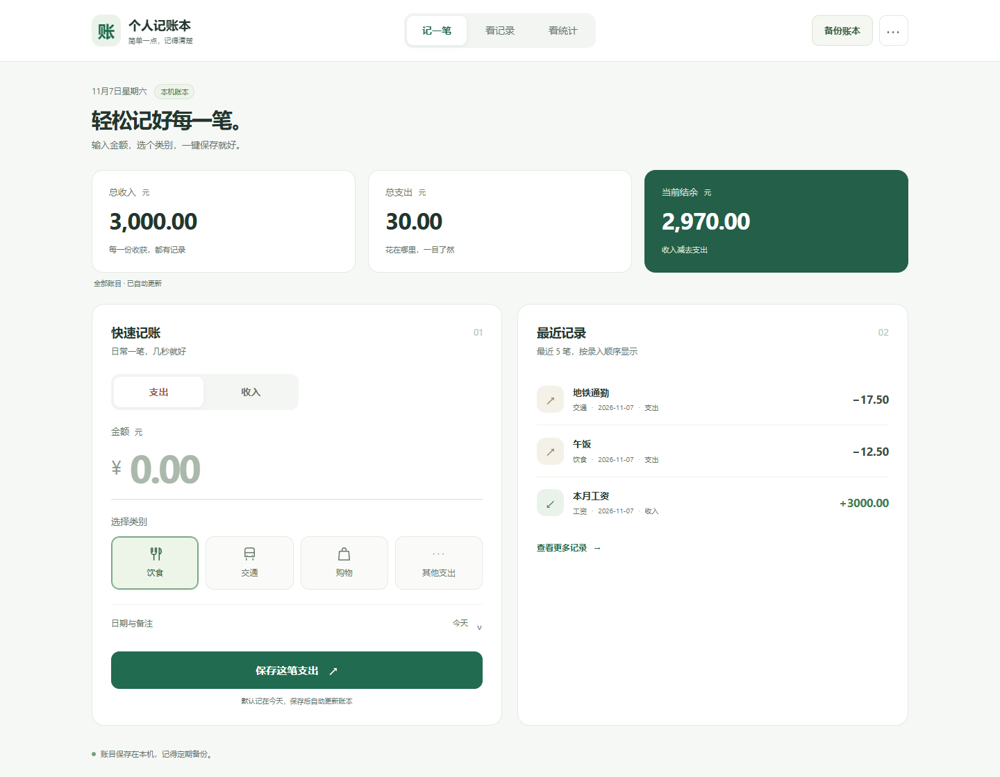

# 个人记账本 Account v1.1.0

[](https://github.com/Ther-ux/Account/actions/workflows/ci.yml)

一个在本机运行的 Web 记账本，已整合成员 01～09 的模块。使用 Go 标准库、原生 HTML/CSS/JavaScript 和本地 JSON 文件，提供快速记账、最近记录、组合筛选统计、收支洞察、月度预算提醒及 JSON/CSV 导出。

本次更新对应本地 `Account_v1.1`，程序版本为 `1.1.0`。原有收入、支出和整数分金额格式保持兼容，前端资源已嵌入可执行文件。



[查看统计截图](media/statistics.png) · [查看手机截图](media/mobile.png) · [观看操作演示](media/demo.webm) · [更新说明](RELEASE_NOTES.md)

## 立即运行

### 从 GitHub 获取源码

源码版需要 Go 1.22 或以上，无 npm 和第三方 Go 依赖。

```powershell
git clone https://github.com/Ther-ux/Account.git
cd Account
go run ./cmd/ledger
```

打开 [http://127.0.0.1:8080](http://127.0.0.1:8080)，用 `Ctrl+C` 停止服务。

### Windows 一键启动

源码目录中双击 `start.bat`，首次需要 Go，会构建并缓存到 `.runtime/`。之后程序自动选择空闲端口并打开浏览器；重复双击会打开已运行的同一账本，不会重复启动。双击 `stop.bat` 可停止真实账本服务；停止演示服务可运行 `stop.bat -Demo`。

本仓库存放源码，不包含 `ledger.exe`。自行构建后，将 `ledger.exe` 与启动脚本放在同一目录，即可在未安装 Go 的 Windows 电脑运行；免安装运行包与 GitHub 源码压缩包需区分。

需要带示例数据演示时双击 `demo.bat`。演示账本存到 `data/demo-records.json`，默认真实账本仍为 `data/records.json`；已有演示账本不会再次灌入示例数据。

端口占用时运行：
```powershell
.\start.bat -addr 127.0.0.1:8081
```

手动演示和构建：
```powershell
go run ./cmd/ledger -demo -open
go build -trimpath -o ledger.exe ./cmd/ledger
```

可用 `-addr` 指定监听地址、`-data` 指定账本路径、`-open` 自动打开浏览器。独立可执行文件不依赖旁边的 `web/` 文件夹。预算是浏览器偏好设置，保存在当前浏览器；账目保存在本机 JSON 文件。

## v1.1 更新内容

- 首页只保留“快速记账”和最近 5 笔，不把所有功能堆在同一屏。
- 日期默认今天，常用收支类型和类别自动记住；通常输入金额后点击保存即可。旧金额和备注不会被自动复用。
- 类别变成大按钮；日期与备注按需展开；成功后概览和记录自动更新。
- “看记录”单独展示记录，可搜索已加载的最近 10/20/100 笔。
- “看统计”提供全部时间、今天、本周、本月快捷入口；复杂条件按需展开，可一键清空。
- 备份账本一键下载；不常用的 CSV 导出和三步帮助放在“更多”菜单。
- 适配桌面与 320 像素起的手机布局，提供键盘焦点与原生表单标签。
- 完成共享 JSON 存储与业务接口接线，提供独立演示账本、嵌入资源和 Windows 启停脚本。

## 必需功能

- 记录日期、收入或支出、金额、类别、备注；日期和类别严格校验。
- 金额按整数分保存和统计，前端精确换算到元；空备注可用。
- 最近记录按录入顺序倒序，补记旧日期仍排在最近位置。
- 日期、类别、金额上下限可组合筛选，端点包含；结余支持负值。
- 成功保存后列表、统计和图表自动刷新；保持已应用筛选，不自动应用未查询的草稿。
- 文件首次使用自动创建；保存失败、文件损坏、读取错误均明确提示，原文件不被静默清空。

## 三项演示亮点

1. 收支洞察：原生 SVG 收支趋势、支出类别占比与精确数据表，跟随统计筛选；趋势展示最近 14 个有记录的日期。
2. 月度预算：预算按月份保存并提示剩余或超支；始终使用所选月份的全部支出，避免被类别筛选低估。
3. 数据与运行可移交：完整 JSON 备份、Excel 友好的 UTF-8 CSV、单文件可执行程序和独立演示账本，适合现场演示。

CSV 保留两位元金额，对可能被表格软件当作公式的备注添加文本前缀。JSON 备份保留原始整数分和备注。导出始终包含全部账目，不受屏幕筛选影响。

## 数据备份与恢复

定期点击“备份 JSON”。恢复时先停止程序，保留现有账本的副本，再将备份文件复制到指定的账本路径。不要同时启动多个进程写同一个 JSON 文件；单进程内通过同一存储实例串行读写。

模型和存储支持 int64 分值。浏览器输入和图表限制在 JavaScript 安全整数范围，超范围会明确报错；JSON 导出不经前端数字解析，保持整数精度。

## 模块对应

| 成员 | 代码 |
| --- | --- |
| 01 | `internal/ledger/record.go` |
| 02 | `internal/store/json.go` |
| 03 | `internal/httpapi/create.go`、`cmd/ledger/main.go` |
| 04 | `internal/httpapi/recent.go` |
| 05 | `internal/httpapi/stats.go` |
| 06 | `web/record.js` |
| 07 | `web/recent.js` |
| 08 | `web/stats.js` |
| 09 | `web/index.html`、`web/app.css`、`web/app.js` |
| 整合增强 | `internal/httpapi/insights.go`、`export.go`、`web/insights.js`、`web/assets.go` |

新增代码没有替换原有三个 API 的公共契约。主程序使用同一个 JSONStore 接入 Create、Recent、Stats，并为洞察和导出提供只读接口。

## HTTP API

| 方法与路径 | 说明 |
| --- | --- |
| `POST /api/records` | 新增账目，成功返回 `201` 和保存的账目对象 |
| `GET /api/records/recent?limit=10` | 最近记录，`limit` 为 `1`～`100`，默认 `10` |
| `GET /api/stats` | 统计收入、支出与结余，返回整数分 |
| `GET /api/insights` | 收支趋势、类别占比与月度支出；可用 `month=YYYY-MM` 选择预算月份 |
| `GET /api/export?format=json` | 导出全部账目，`format` 支持 `json` 或 `csv` |
| `GET /api/meta` | 查询程序版本与是否为演示模式 |

账目请求示例：

```json
{
  "date": "2026-11-07",
  "type": "expense",
  "amountCents": 1250,
  "category": "饮食",
  "note": "午饭"
}
```

`amountCents` 是正整数分，`1250` 表示 `12.50` 元；备注可省略或留空。收入类别为工资、奖金、其他收入；支出类别为饮食、交通、购物、其他支出。

统计与洞察均支持组合使用 `from`、`to`、`category`、`minCents`、`maxCents`，日期与金额区间包含端点。参数错误返回 `400`，存储失败返回 `500`，错误格式为 `{"error":"具体原因"}`。

## 验证与协作

在仓库根目录执行：

```powershell
go test ./...
go vet ./...
go build -trimpath -o ledger.exe ./cmd/ledger
```

GitHub Actions 在推送和 PR 时执行 Windows/Linux、Go 1.22/stable 的格式、测试、静态检查和构建，并在 Linux 执行 race detector。运行结果以 [Actions 页面](https://github.com/Ther-ux/Account/actions) 为准；该工作流不自动发布 Release。

版本包附带的验证记录为 37 个 Go 测试入口、含子测试共 222 项通过，以及 20 组浏览器检查。详细范围及限制见 [VALIDATION.md](VALIDATION.md)，原始结果在 [verification/](verification/)，截图与录像在 [media/](media/)。

代码整合来源和校验信息见 [INTEGRATION.md](INTEGRATION.md) 与 [SOURCE_MANIFEST.json](SOURCE_MANIFEST.json)。仓库保留原有成员提交历史和 [贡献说明](docs/contributions/)；根目录 `README_提交说明.md` 记录的是早期成员提交包，当前运行方式与接线状态以本 README 和 v1.1 源码为准。

后续协作请从最新 `main` 创建个人分支，提交负责模块后发起 PR。团队成员姓名学号、个人贡献链接和 [团队博客草稿](TEAM_BLOG_DRAFT.md) 由成员按实际情况补齐。本地 `data/`、`.runtime/`、构建产物和日志均不提交到仓库。
