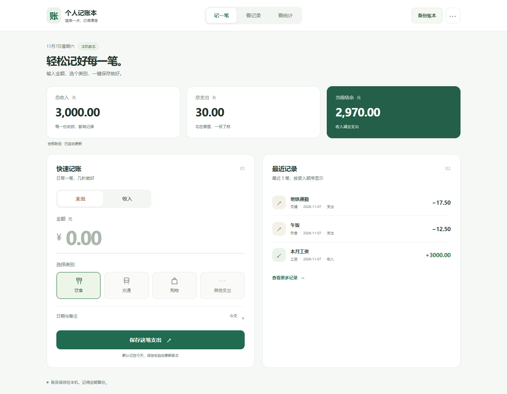

# 个人记账本团队博客草稿

以下为可编辑材料，姓名、链接、个人体验和真实协作过程由团队填写，不把整合包当作个人提交证明。

| 项目 | 内容 |
| --- | --- |
| 作业所属课程 | [班级与课程链接] |
| 作业要求 | [要求链接] |
| 作业目标 | 实现可持久化的个人记账、查询统计，完成模块协作与真实版本交付 |
| 团队名称 | [填写] |
| 团队成员姓名 学号 | [逐一填写九人] |

## 分工与环境

九人代码职责见 README 模块表，补充各人的真实姓名、学号、commit/PR 链接。实际验证环境为 Windows amd64、Go 1.27.3、Chrome 156.0.8078.80。

## 软件截图和视频

手机界面见 media/mobile.png；真实操作录像见 [演示视频](media/demo.webm)。画面均使用独立演示账本。发布到博客时替换为读者可访问的图片和视频地址。

## 关键实现

- internal/store/json.go：同一存储实例串行读取与追加，临时文件写入检查后替换，损坏账本不重置。
- internal/httpapi/stats.go：全部筛选条件 AND，包含端点，整数分累计与溢出检测。
- web/stats.js、web/insights.js：区分草稿与已应用条件，图表跟随筛选，预算始终使用整月支出。
请从最终代码截取实际函数，添加本人理解和必要注释。

## 一至三项亮点

1. 收支趋势、支出构成、精确数据表联动。
2. 按月保存预算，并在超支时提醒，口径独立于筛选。
3. 完整 JSON/CSV 备份、无前端构建链的单文件运行和独立演示账本。

## 至少三件真实事件

可依据本次实际整合问题继续整理：公共模型与接线合并；存储错误与损坏文件处理；筛选和预算统计口径分离。团队需补充真实参与人、发生时间、尝试、取舍、耗时与证据，不能虚构成已经发生的组内争论或个人经历。

## 九位成员体验

1～9 号各自填写本人实现、对接困难、复审收获与改进。不能由一个人代编九种体验。

## GitHub 与 Release

仓库：[填写最终专用仓库]；Release：[填写实际链接]；验收 SHA：[填写真实 SHA]。保留各成员真实提交与复审记录，核查仓库、博客和视频链接的访问权限。

## 贡献评分

组长按实际贡献填写九人的分数，不能全部同分，合计应为组分乘以 9。此处不预填分数。
