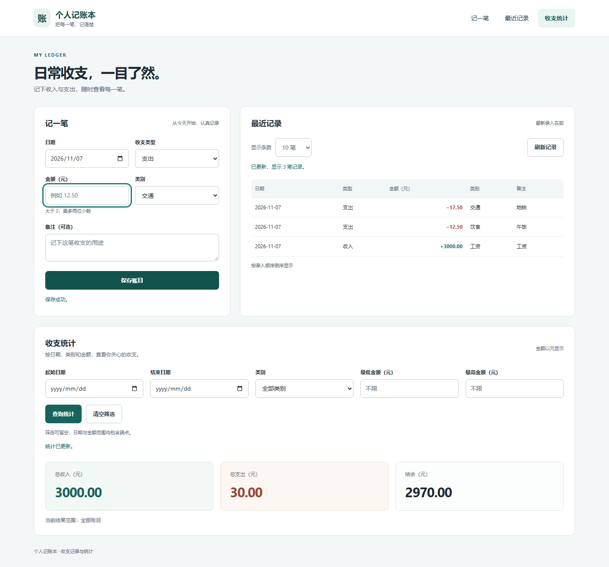
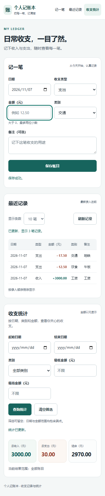

# 任务 9：页面框架、导航与任务 1–8 联调

验证日期：2026-11-07（北京时间）。本次由 Codex 辅助修改、验证和提交；姓名、学号、本人复核记录和个人编程体验由本人据实填写。

## 来源与提交范围

基于已有任务 9 分支 `feature/page-shell` 的 `a83d8ee`，合入主分支 `ed2df74294994b7882cf60d213df268ab6c226a0`，保留任务 1–8 的原始提交。此前草稿 PR 等待的 `web/record.js`、`web/stats.js` 已在主分支到位，三个业务脚本均使用实际实现。任务 9 的 PR 为 <https://github.com/Ther-ux/Account/pull/9>。

| 文件 | 最终行为 |
| --- | --- |
| `web/index.html` | 中文首页、三个区域及固定容器、锚点导航、跳到主要内容链接；加载本地 CSS 与 ES 模块入口 |
| `web/app.css` | 适配 6–8 号的表单、列表和统计 class；统一加载、成功、错误、空状态；统计请求期间弱化旧结果；支持窄屏、焦点和减少动画偏好 |
| `web/app.js` | 独立导入三个真实模块，每个容器只初始化一次；维护导航状态；等待初始化结果，使同步异常与异步拒绝都进入对应面板的错误提示 |
| `cmd/ledger/main.go` | 应用三号已提交的 `member03-wiring.patch`，创建一个共享 JSONStore，将三个 API 接到实际处理函数，替换 501 占位 |
| `README.md` | 更新真实完成状态、运行方式和验收入口 |
| `docs/screenshots/member09-*.png` | 本次真实浏览器桌面与手机截图，使用隔离的示例账本 |

服务接线属于三号此前已完成的补丁，本次仅在依赖齐全后应用。`internal/` 和 `web/record.js`、`web/recent.js`、`web/stats.js` 的业务代码没有重写。原补丁及历史交接文档保留为来源记录，当前入口已接通，无需再次应用补丁。

## 接口与装配

- `initRecord(record-panel)`、`initRecent(recent-panel)`、`initStats(stats-panel)` 保持导出和容器约定；应用入口不承担金额换算、筛选、文件读写或事件广播。
- 六号在成功保存后发送 `window` 的 `ledger:changed`；七号、八号各自监听并刷新；统计按已应用的条件查询，未提交的表单草稿不会改变刷新范围。
- 页面保留 `record`、`recent`、`stats` 三个 section，全部直接可见，浏览器原生锚点负责跳转和键盘焦点，`aria-current` 随 hash 更新。
- 三个接口分别调用 `Create(records.Append)`、`Recent(records.List)`、`Stats(records.List)`，共用一个存储实例。生产页面没有模拟数据、缺失脚本或外部字体与框架依赖。

## 实际验证

Windows/amd64；便携 Go 1.27.3（项目 `go.mod` 仍为 Go 1.22）、Node、Python Playwright 与本机 Chromium。二进制运行于独立临时目录，复制正式 `web/`，以真实 HTTP 和 JSON 文件完成联调；没有读写用户已有账本。

| 验证 | 结果 |
| --- | --- |
| `go test -count=1 ./...`、`go vet ./...`、构建正式入口 | 通过；现有 API 和模型测试通过，store 包当前没有提交测试文件，不宣称它有单元测试覆盖 |
| 四个 JS 文件的 `node --check` | 通过 |
| 首次启动 | 表单可用，最近记录显示空状态，统计三项为 `0.00` |
| 模块与资源 | 四个 JS 均只加载一次；三个真实模块初始化；正常流程没有控制台异常、页面异常、404 或其他 HTTP 错误 |
| 初始化异常隔离 | 另行注入最近记录模块的异步初始化拒绝，错误只显示在对应面板；表单与统计正常初始化，未产生未处理的页面异常 |
| 键盘与导航 | Tab 可到达跳过导航链接；Enter 聚焦主内容或对应 section；三个导航的 `aria-current` 正确 |
| 非法金额 | 显示错误，标记并聚焦字段，不发送保存请求 |
| 三笔实际表单保存 | 工资 `3000.00`、饮食 `12.50`、交通 `17.50`；每次返回 201、清空金额与备注；列表按录入倒序刷新；统计为 `3000.00 / 30.00 / 2970.00` |
| 组合筛选与包含端点 | 日期 `2026-11-07`、类别交通、最低和最高金额均 `17.50`，显示支出 `17.50`、结余 `-17.50` |
| 当前条件刷新 | 将类别改为购物但不提交，再保存交通 `17.50`，统计仍按已应用的交通条件刷新到支出 `35.00` |
| 补记及清空筛选 | 新录入旧日期的奖金 `10.00` 排在列表首条；备注 `<b>补记</b>` 显示为文字；清空筛选得到 `3010.00 / 47.50 / 2962.50` |
| 窄屏与桌面 | 1440、768、390、320 像素宽度均无页面横向溢出；导航和全部表单控件在可用宽度内；检查桌面与手机截图 |
| 有意注入 500 响应 | 保存失败保留输入；统计失败保留且标记旧结果、显示错误与重试按钮；恢复后重试成功。该项是专门的失败测试，与正常流程无 HTTP 错误分开记录 |
| 真实错误路由 | 非法账目、`limit=0`、颠倒的金额区间均返回 400 |
| 重启持久化 | 停止并在同一临时目录重启正式二进制，五条记录、顺序及三项统计完全一致 |

本机验证脚本为 `C:/Users/zhang/.codex/tmp/ledger-member09-verify.py`，结果和原始截图位于 `C:/Users/zhang/.codex/tmp/ledger-member09-verification/`。这些本机路径仅用于保留原始证据，不是运行依赖。

## 可复现的人工验收

1. 在独立目录复制正式代码或构建产物与 `web/`，从空账本启动 `go run ./cmd/ledger`，访问 `http://127.0.0.1:8080`。
2. 逐笔录入上述三条示例数据，检查列表顺序与三项总额；查询交通、同一天及金额端点，随后清空筛选。
3. 保持已应用筛选，填写但不提交另一组条件，新增记录，确认统计仍按已应用条件刷新。补记旧日期，确认列表按录入顺序排列。
4. 用 Tab / Enter 访问跳过导航链接、三个导航和表单；以 320、390、768、1440 像素宽度检查控件与表格滚动。
5. 停止并重启服务，核对数据仍在。浏览器开发工具模拟失败请求，检查失败提示、输入保留与重试恢复。

## 实际截图

桌面（1440 像素）：

手机（390 像素）：

